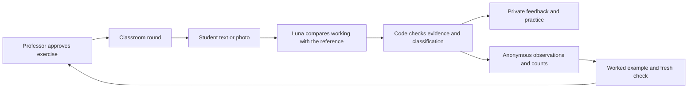

# Running and inspecting QAI

## Setup

From the repository root run `npm ci && npm start` with Node 22.16 or newer. This downloads and verifies the pinned local encoder before starting the server. Follow the professor URL printed in the terminal. Phones join through the projector QR, using an address reachable by the room. The hosted demo uses HTTPS. Set `PUBLIC_ORIGIN` when hosting elsewhere.

The open classroom uses `gpt-6-luna` through the OpenAI Responses API when `OPENAI_API_KEY` is configured on the server. Override with `OPENAI_QUIZ_MODEL`. Live requests are capped at 30 per process per UTC day. When the provider is unavailable, supported text exercises can use local analysis. Photos require the live vision provider. `npm run demo` launches the deterministic rehearsal without a key. The private professor cookie authorizes publishing, closing and viewing the report.

## Architecture

| Component | Classroom behavior |
| --- | --- |
| Inputs and course knowledge | A professor uploads a worksheet or image, or pastes a prompt. PDF.js extracts pages, Tesseract can read scanned material, and the professor reviews the selected exercise and private reference. Three authored examples cover calculus, statistics and mechanics. |
| Question preparation | The server retrieves related course material with MiniLM when available. Luna suggests a reference and likely reasoning patterns. The professor edits the draft and decides when to publish. Teacher and student views share one round ID. |
| Student review | Luna reads text or the submitted image against the approved prompt and reference. It identifies a supporting step, classifies the reasoning, and proposes focused practice. The server checks that textual evidence occurs in the submission and routes uncertain work to review. |
| Tool execution | The open classroom runs a fixed prepare, review and report workflow. The companion calculus notebook implements an explicit model-directed tool loop. Its tools retrieve a course note, recall a previous hint, test a proposed derivative, record an observation or request human review. |
| Memory | The room tracks each participant’s latest attempt and replaces revisions in the aggregate. A nickname is optional. The leaderboard counts participation. The browser retains personal study history and nickname across visits. The notebook remembers prior hints for the browser. Live class state resets when the server restarts. |
| Outputs and privacy | Students see their own feedback. The instructor sees anonymous counts, observed difficulties and a next teaching step. The projector shows the prompt and participation count. Photos are available only through the submitting student’s session. |
| Guardrails and evaluation | Input limits, presenter authorization, schema checks and closed-round checks run in code. The notebook limits steps and hands uncertain cases to the tutor. Logs identify actions and outcomes. Tests cover conflicting evidence, ambiguous answers, privacy, revisions and tool limits. |

The browser uses plain JavaScript with server-sent events and polling for reconnects. KaTeX and Markdown-it render the question preview. Lucide supplies action icons. ONNX Runtime and Hugging Face tokenizers run the local MiniLM encoder.

[Open classroom implementation](quiz/open.mjs) · [Notebook orchestrator and tools](agent/orchestrator.mjs) · [Notebook system instructions](agent/instructions.md) · [Model adapters](agent/providers.mjs)

## Student whiteboard

Choose **Whiteboard** to sketch with a mouse, pen or finger. Undo removes one stroke. Students can switch to Write and return to their sketch during the same question. **Submit drawing** sends the board and optional note to the same private image-review path as a photo. Local rehearsal saves drawings as unassessed. QAI adapts the [drawing pad from Rick’s branch](https://github.com/iiMaximus/reply_hackathon/blob/82632e1/public/ui.mjs) for live classroom updates.

## Inspect the bounded agent

Launch `npm run live` with a configured key and open the printed professor link to authenticate. Then use `/present?view=notebook` and `/join?view=notebook`. The live notebook defaults to `gpt-6.1-terra` and accepts an `OPENAI_MODEL` override. Try the Analisi I example with the proposed derivative f′(x) = 2 + x². The slope tool can compare the proposed and actual slopes at a test point. Ask for the finished answer or submit unreadable work to exercise the human handoff. `npm run demo` rehearses the tool sequence with a scripted planner.

## Verify

Run `npm test` for classroom, agent and role-boundary tests. Run `npm run test:model` after model preparation for the local encoder check. The GitHub Actions workflow exercises the real Luna provider using the repository Actions secret. The synthetic calculus evaluation publishes its student-level results and professor report in the job summary. The repository includes a [captured run](../submission/classroom-evaluation.md).

## An agent interaction at its boundary

In the calculus notebook, the instruction “give me the final answer” can select the terminal `ask_tutor` tool with the reason `answer_request`. The learner is prompted to show a step and no solution is recorded for them. A fabricated tool or invalid arguments cannot update memory. The orchestrator validates the selection and stops at its configured budget. [Agent tests](agent.test.mjs)

